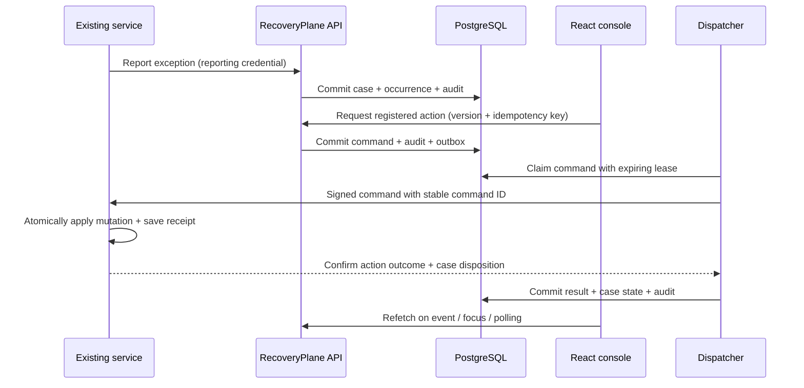

# RecoveryPlane

**Bring operations back on track.**

RecoveryPlane is a self-hosted console for business operations that need human attention. An existing service reports an exception, an operator requests a registered recovery action, and that service executes the action and confirms the outcome.

The complete recovery loop works locally: real API requests, PostgreSQL transactions, signed HTTP delivery, durable origin receipts, and a React console. The included vendor demo deliberately distinguishes **“country updated”** from **“onboarding recovered.”**

## Run it

Requires **Node.js 22+** and **pnpm 9.1.0**. No Docker, cloud credentials, or identity-provider account is required for the local demo.

```sh
pnpm install --frozen-lockfile
pnpm dev
```

Open [localhost:5173](http://127.0.0.1:5173), choose **Operator**, and select **Open demo workspace**. The first launch seeds three vendor exceptions through the reporting API. Embedded PostgreSQL persists data in `.data/recoveryplane`, which is excluded from Git. The API runs on port 3000; the signed demo origin runs on port 3001.

If pnpm is missing, install it with `npm install -g pnpm@9.1.0`. On PowerShell, use `pnpm.cmd` if the execution policy blocks the `pnpm.ps1` shim.

Do not copy `.env.example` for the quick demo. It documents secure pilot configuration and sets `DEMO_MODE=false`. `pnpm dev` defaults to demo mode only when that variable is unset. Stop the processes before opening the same embedded database from another process.

## Your first recovery

1. Open a vendor case in the inbox.
2. Choose a country under **Update vendor details**, review the target and inputs, and confirm.
3. Wait for the origin result: the action succeeds, but the **case remains open**.
4. Run **Retry verification**. The origin verifies the vendor and explicitly confirms recovery.
5. Inspect the command deliveries and audit timeline. **Demo lab** shows the vendor’s persisted status and mutation count.

Try the **Duplicate exception reports** scenario: ten deliveries create one occurrence. Try **A response lost in transit**: the origin commits an action and drops its first response; RecoveryPlane shows an unknown outcome and redelivers the same command. The origin’s receipt prevents a second mutation.

## What is included

- Searchable exception inbox, status/source/priority filters, assignment, notes, and reasoned dismissal.
- Schema-driven action forms, input confirmation, current permission/revocation checks, and version-conflict handling.
- Integration provisioning, one-time reporting/signing credentials, immutable action versions, and enable controls.
- Separate case and command lifecycles, visible unknown outcomes, manual same-command reconciliation, and an append-only audit table.
- ADMIN / OPERATOR / VIEWER roles and tenant-scoped access. Machine reporting keys cannot provision actions.
- React, TypeScript, Vite, TanStack Query, Lucide icons, and Motion for React. Native scrolling, a recovery walkthrough, and reduced-motion support.
- TypeScript SDK, [HTTP integration guide](docs/INTEGRATION.md), local vendor origin, Docker configuration, and GitHub Actions.

## How it works



The same SQL repository supports [PGlite](https://pglite.dev/docs/) locally and a PostgreSQL server through `pg`. The local API hosts the dispatcher and demo origin in one process; the demo origin uses separate vendor/receipt tables in that database. With server PostgreSQL, the dispatcher can run separately using `pnpm worker` and `DISPATCHER_ENABLED=false` on the API.

Delivery is **at least once**, never exactly once. A durable outbox replaces the previous scaffold’s unfinished Redis queue. A new transport can be introduced later without changing command identity or transaction guarantees. See [architecture and failure windows](docs/ARCHITECTURE.md) and [decisions](DECISIONS.md).

## Verify

```sh
pnpm build
pnpm test
```

The tests cover full-payload report deduplication, correlation conflicts, tenant/role boundaries, simultaneous commands, revoked actions, signed raw bodies, duplicate/conflicting results, lost responses, expired leases, stale workers, DNS deadlines, graceful shutdown, append-only audit, and persistence across restart. The HTTP integration test talks to an actual local origin over signed HTTP.

GitHub Actions additionally runs the domain and HTTP suites against PostgreSQL 16. To run those manually, set `TEST_DATABASE_URL` to a **dedicated test database** and run `pnpm test:postgres`. Tests create durable fixtures; never point them at a customer database.

Local validation uses embedded PostgreSQL. Docker and server-PostgreSQL CI are configured, but must pass in your environment before treating those deployment paths as verified. No load or production security certification is claimed.

## Docker demo

```sh
docker compose up --build
```

Open [localhost:3000](http://127.0.0.1:3000). Compose runs PostgreSQL and serves the built console/API together. It exposes the app on loopback only and uses a named volume. Its default database password and demo roles are for local sample data only. Existing `.env` values override Compose defaults.

## Self-hosted pilot

1. Run `pnpm token:create`. Save the raw token privately and put the generated hash/user mapping in `ACCESS_TOKENS_JSON`.
2. Copy `.env.example` to `.env`, keep `DEMO_MODE=false`, and set `DATABASE_URL` for PostgreSQL if needed.
3. Run `pnpm build`, then `pnpm start`. Open [localhost:3000](http://127.0.0.1:3000) and enter the token.
4. As an admin, create an integration with a public HTTPS callback. Save its one-time credentials and register its recovery actions. Connect the origin using the [integration guide](docs/INTEGRATION.md).

For remote access, use an HTTPS reverse proxy, protected secrets, database backups, network egress restrictions, and per-client rate limiting. Read [SECURITY.md](SECURITY.md) before deployment. Access tokens are provisioned configuration; this release does not yet include SSO, MFA, self-service organization management, credential rotation, or independent approvals.

## Repository

| Path                          | Responsibility                                         |
| ----------------------------- | ------------------------------------------------------ |
| `apps/web`                    | React operator console                                 |
| `apps/api`                    | HTTP auth, domain operations, demo bootstrap           |
| `apps/worker`                 | Durable dispatch, leases, destination validation       |
| `apps/vendor-onboarding-demo` | Origin preconditions, mutations, command receipts      |
| `packages/contracts`          | Zod contracts and action schema subset                 |
| `packages/database`           | Shared SQL schema and PostgreSQL adapters              |
| `packages/sdk`                | Reporting client and raw-body signing utilities        |
| `tests`                       | Domain, HTTP, lifecycle, persistence and failure tests |

## Current limits and next steps

This is a working self-hosted pilot and portfolio release. Lists are not paginated, tenant writes are serialized, dispatch is sequential, and rate limiting is process-local. Establish measured capacity before adopting it for high-volume workloads. The app does not own or automatically resume arbitrary workflow execution.

Next useful increments are a second real execution environment (for example n8n), pilot feedback, pagination, identity-provider login and credential rotation. Broader approvals, AI advice, and Kubernetes should follow an observed need. Related cases currently use deterministic fingerprints; they do not claim causal recommendations.

MIT licensed. External library and visual asset credits are in [THIRD_PARTY.md](THIRD_PARTY.md).
